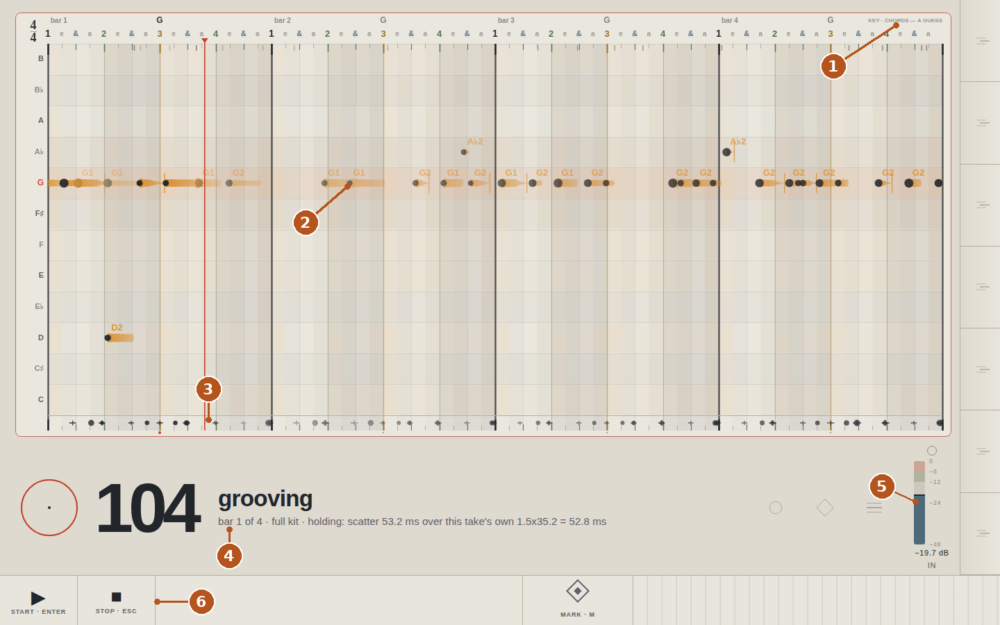
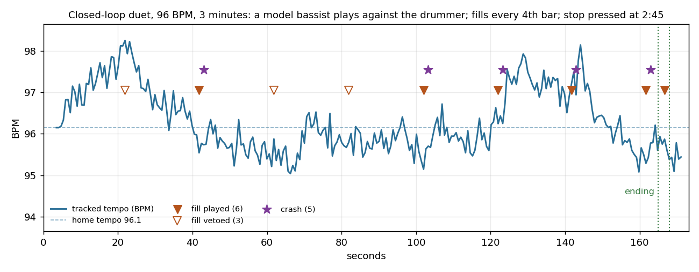

# sideman: a drummer that plays with my bass

*Public summary, 2026-11-01. The working repository is private; the excerpts below are the parts worth showing.*

## The problem I wanted to solve

Practising bass alone means playing to a click, or to nothing. A drummer does something a click cannot: locks onto the pulse, predicts where the next beat will land, commits a hit slightly before it and corrects continuously. I wanted that drummer on my desk, listening to a DI bass through a USB interface and playing a sampled kit, on a Jetson AGX Orin, with every session logged by sample index so that any musical question ("why did it speed up at bar 30?") can be answered offline with numbers rather than opinions.

## Demonstration

The panel, captured while a take of mine (recorded 2026-11-01) was fed back through the live audio path:



1. Key and chords guessed by the listener from my audio alone (here G), marked as a guess.
2. My notes, named by pitch (G1, G2, D2, A♭2), drawn where they actually sit between the 16th-note ticks, with an attack head and an envelope body that fades with the note.
3. What the drummer played, one lane under the bars.
4. Tempo and the state in words: grooving, bar 1 of 4, full kit, and a falter hold with the measured scatter and its threshold, so the reason for every decision is on the screen.
5. Input meter with the target band, so a bad gain is visible before a bad take.
6. Transport, marker key and the hand brake (`[` `]` `\`) that nudges the home tempo.

Two short clips from a closed-loop duet (a model bassist playing against the drummer at 96 BPM; drums at −6 dB):

- [`sideman-first-fill-and-crash.wav`](assets/sideman-first-fill-and-crash.wav): the first fill in the last bar of a phrase, then the crash on the downbeat (12 s).
- [`sideman-ending.wav`](assets/sideman-ending.wav): stop pressed; the drummer finishes the phrase with a fill, crash and kick on the one, and lets it ring (11 s).

And the tempo trace of that duet, which is how every change gets judged:



The pair drifts within about ±1 % of the home tempo, fills land every fourth bar unless a stumble vetoes them, and the ending lands on a downbeat.

## Architecture and my contribution

```
bass DI → USB interface (48 kHz) → T0 audio callback (256 frames)
   → T1 control thread: onset front end → co-leading Kalman PLL (tempo, phase)
        → home tempo spring + push absorber → falter / adapt detectors
        → controller: one bar ahead from a library of human grooves (GMD), fills, crash, ending
        → sampler → T0 output, every hit scheduled at t_grid + feel − output_latency
   → T2 logger: events.jsonl by sample index, bit-for-bit replayable
   → panel server: browser front panel (yardstick, listener: key / chords / notes)
```

This project is built as a three-role collaboration that I designed and run:

- **I** set the goals, make every musical decision by ear (co-leader tempo, when the drummer may comment, how long a phrase is), record the takes, measure the hardware, and merge the agent's branch by hand.
- **Claude in chat** drafted the v0 specification with me and issued the numbered briefs.
- **Claude Code** built the code in its own git worktree, one brief at a time, and returned a report per brief with a judge table, numbers with their denominators, and an explicit list of what was not done.

The engineering process is the part I claim most: constants have one home (the spec), every rate names its numerator and denominator, an empty evidence set is a failure rather than a pass, and every session replays byte-for-byte, which turned the question "does it feel right?" into measurements the agent could act on. Over eight briefs that produced an onset front end, the Kalman PLL, a 2 400-groove library with 151 fills, a closed-loop duet harness with a model bassist, the live loop, the panel, and 154 tests.

## What works today, what remains experimental

| Works (measured) | Experimental or open |
|---|---|
| Live loop: count in by playing, drums lock and follow; 0–2 buffer xruns per 30 min at 256 frames | I cannot yet hear myself at 0 ms: the interface has no direct monitor, and the 26 ms software monitor makes the pair run away (0 of 9 duets hold). Every live test waits on a mixer or a different interface |
| Tracker follows deliberate tempo changes, resists creep, holds the groove through a stumble, rests and re-enters | Three rulings pending on my ear: re-home after a tempo change (the "never" arm holds 9 of 9), fill rate, strength weighting |
| Fills at phrase ends, crash on the next downbeat, musical ending; 0 misplaced over 1 327 bars | Fill gate is calibrated for offers: on my own audio 46 of 52 phrase ends were vetoed as "faltering" |
| Deterministic replay with md5 parity; acceptance runner per brief | Control thread at 109 % of a block at p99 in Python; the plan is C++ for the two real-time tiers |
| Round-trip latency measured by loopback: 26.08 ms, identical at 128 and 256 frames | Where the hits land in the air has not been measured (needs the loopback cable patched) |
| Panel: notes, key, chords, input meter, reasons in words | Funk and soul in 4/4 only; the phrase is counted from the count-in, not heard |

## Representative code

The tempo "chase" was the hardest bug: a bassist who anticipates the drums and a drummer who phase-corrects toward the bassist's notes accelerate together. The obvious fix, a stronger spring on the period, was measured and failed at every strength, because the acceleration travels through the phase correction. What holds is what a human drummer does: sit back by the amount the bassist pushes. The two methods below encode the rule I insisted on throughout: the drummer may bias its prediction, but never assigns the clock.

```python
def _apply_tempo_pull(self, f) -> None:
    """The spring toward home. Outside ADAPTING, the *prediction* of the period is biased
    toward T_home by pull_frac_per_bar of the gap, capped per bar, a quarter per beat.
    Never an assignment to phi or T: the next onsets can overrule it."""
    h = self.home_cfg
    if f is None or self.T_home is None or self.adapting or not bool(h.get("enabled", True)):
        return
    bpb = self.tracker.metronome.beats_per_bar
    gap = self.T_home - f.T
    step = float(h["pull_frac_per_bar"]) / bpb * gap
    cap = float(h["pull_cap_pct_per_bar"]) / 100.0 / bpb * abs(f.T)
    f.x[1] = f.T + float(np.clip(step, -cap, cap))

def _absorb_push(self) -> None:
    """Sit back against a pushing bassist. The persistent part of the innovation (its mean
    over each beat's onsets, integrated slowly) lays the drums back from his pulse.
    Scheduling only: the tracker still follows his notes. Frozen while ADAPTING, because
    a sustained sign there is intent, not push."""
    nu, self._beat_nu = self._beat_nu, []
    h = self.home_cfg
    if h is None or not bool(h.get("push_enabled", False)) or self.adapting or not nu:
        return
    g = float(h.get("push_gain_per_beat", 0.05))
    lim = ms_to_samples(float(h.get("push_max_ms", 60.0)))
    self.push = float(np.clip(self.push - g * float(np.mean(nu)), -lim, lim))
```

*Excerpt from the controller, docstrings shortened. Written by Claude Code to my brief; the measurement that chose it over the stronger spring (8 of 9 duets held versus 0 of 9) is in the brief's return.*
